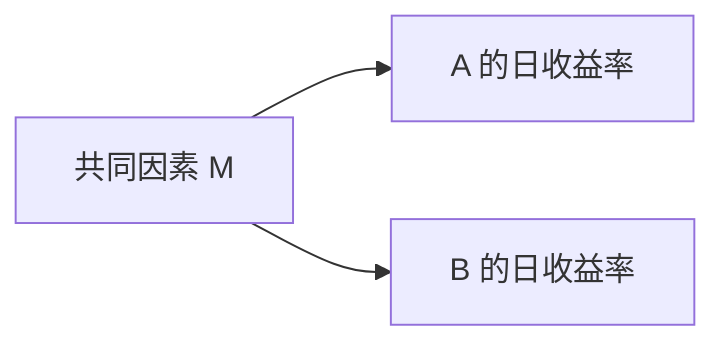

# 第8周：用统计描述数据，认识随机性

依据：[24周学习计划](../learning-plan.md)。本周使用明确标注的虚构或模拟数据；不读取最终测试行情。实际状态以[学习进度](../learning-progress.md)为准。

## 本周安排

| 课次 | 内容 | 完成条件 |
| --- | --- | --- |
| W08D01 | 均值、价格与收益率、平均与累计 | 能说明所平均的对象和单位，计算短序列收益，解释算术平均不等于累计收益、价格高低不直接决定收益率 |
| W08D02 | 分位数与方差的手算 | 先讲排序位置、分散程度及计算约定，再手算小样本，解释均值相同仍可有不同波动 |
| W08D03 | Python与固定种子的模拟序列 | 明确生成规则、种子、单位及模拟标签；核对手算，解释输入输出及重复实验含义 |
| W08D04 | 相关与因果、样本数量、随机赢家 | 用预先设定的对照实验说明共同变化不证明因果、筛选赢家可能来自随机性；种子固定不证明真实规律 |
| W08D05 | 小测、实验解释与周验收 | 小测建议至少4/5，能独立解释价格/收益率、统计摘要及随机赢家实验；通过后进入第9周并衔接已确认的MLF-W01 |

W08D01至W08D04均已完成；W08D04的B-R两项通过，结合A、原B已通过部分及区间选择澄清达到既定条件，无待补答，整课30分钟已确认并累计一次。此前教师订正及示例歧义保留归属，不记整课首答全对。W08D05未开始，第8周周验收尚未完成。

## W08D01：均值，以及价格和收益率的区别

### 为什么先学这个

上周学习的是数据能否正确读取、口径是否一致。本周开始问：拿到一串数据，怎样概括它？同样叫“平均”，平均价格、平均每期收益率和整段持有收益回答的是不同问题，必须先选对对象。

本课“均值”特指算术平均数：把同类观测值相加，再除以观测个数，每个观测权重相同。它保留原数据的单位，概括这组观测的平均水平；不表示每个观测都等于它，也不保证以后出现它。

### 完整示范：一份虚构ETF的价格路径

以下均为教学虚构数据。D0、D1、D2是连续三个交易日收盘观察时点；价格单位为美元/份，三项价格对应两个相邻交易日区间。为单独理解价格变化，假定没有分红、拆股、费用或资金追加/取出，始终持有同一份ETF。下列市值路径是按给定价格估值的数学例子，不是实际订单成交承诺。

| 观察时点 | 每份收盘价 | 相对上一个观察时点的价格收益率 |
| --- | --- | --- |
| D0 | 100美元 | 无前一个价格，不能计算，不填0 |
| D1 | 110美元 | (110−100)/100 = 10% |
| D2 | 99美元 | (99−110)/110 = −10% |

**平均价格：**(100+110+99)/3 = 103美元/份。这里平均的是三个时点的单价，不是三笔赚到的钱。103不必等于任一实际观测价格，也不自动等于个人买入成本。

**单期价格收益率：**(本期末价格−本期初价格)/本期初价格。它衡量这一个区间相对起点的变化比例。第一段每份涨10美元，起点100；第二段每份跌11美元，起点110，因此幅度同为10%而金额不相同。

**算术平均单期收益率：**[10%+(−10%)]/2 = 0%。平均的是两个区间的变化率，分母是2，不能把D0缺少的收益率补成0再除以3。它描述这两个已观察区间，不表示每天都没涨跌，也不是对下一天收益的保证。

**累计收益率：**从D0持有到D2，一份市值从100变成99美元，累计收益率为(99−100)/100 = −1%；也可按(1+10%)×(1−10%)−1 = −1%计算。单期收益率的算术均值按观测值等权平均，持有金额却逐期按变化后的基数增长或缩小，因此算术平均为0%不等于累计收益为0%。累计收益也不能用“算术平均×期数”一般地代替。

本例无分红及费用，价格收益与这份持仓的收益相同；有分红、费用等时，实际总收益要按相应口径另算，不能将普通收盘价变化自动当总回报。

### 价格尺度的对照

另一份虚构ETF的同期价格为200、220、198美元/份。价格都是前例的两倍，平均价格为206美元/份，但两段价格收益率仍为10%、−10%，累计仍为−1%。一份持仓对应的美元变化更大，却不代表每投入1美元赚取的比例更高。比较增长比例时应计算一致区间与口径的收益率，不能仅凭单价高低排序。

<a id="w08d01-a当前待答练习"></a>

### W08D01-A：原题保留，已通过

以下均为虚构数据。D0、D1、D2为连续三个交易日收盘观察时点；价格单位美元/份。假定没有分红、拆股、费用或资金追加/取出，从D0至D2始终持有同一份；所有计算仅按给定价格估值。

| 观察时点 | ETF甲 | ETF乙 |
| --- | --- | --- |
| D0 | 50 | 100 |
| D1 | 60 | 120 |
| D2 | 54 | 108 |

1. 甲有几个可计算的单期收益率？分别是多少？写出算式。
2. 甲的平均价格、算术平均单期收益率、D0至D2累计收益率各是多少？写出算式，并用自己的话说明：平均单期收益率和累计收益率为什么可以不同？
3. 乙的单价始终是甲的两倍，能否据此说乙这两段期间的累计收益率更高？用计算说明。甲的算术平均单期收益率能否保证下一期取得同样收益？简述理由。

发题时的提示与归属：上方100→110→99及两倍价格对照是教师完整示范；已给通用公式，没有提供本练习答案。发题时三题尚无用户作答，不计掌握或得分。现已收到作答并完成反馈，见下方结课记录；原题保留，不再待答。

### 开课记录（2026-11-14）

用户主动继续学习，W07D05和第7周已完成状态保持，开始W08D01。已准备并在本轮呈现均值、价格/收益率口径、两个区间的计算、平均与累计及价格尺度对照；A组三题待答。本课未完成，完成课次仍35/120，已确认总时长约588–603分钟不变。W07D04/W07D05用时仍待补报，W08D01用时尚未确认。本轮仅教学与文档维护，不读取或改写行情、不运行模拟或策略程序、不新增测试执行记录。

### W08D01-A反馈与结课（2026-11-14）

- A1：用户独立指出甲有两个可计算的单期收益率，给出(60−50)/50=20%，第二段结果−10%正确；第二段原式写成“(54−60) = −10%”，遗漏分母。教师补全为(54−60)/60=−6/60=−10%，说明单独54−60得到的是每份减少6美元。结合第一段和后续收益率计算，记录为算式书写遗漏，不推断为不懂收益率分母；不记为用户自行补正，也不要求重复验收。
- A2：用户独立算出均价(50+60+54)/3=54.667美元、平均单期收益(20%−10%)/2=5%、累计收益(54−50)/50=8%。均价舍入正确，教师将表达精确为“约54.667美元/份”，保留近似号和单位补充归属。用户自行解释平均各期收益率与比较期末/期初整体变化是不同计算对象，核心通过。教师另用(1+20%)×(1−10%)−1=8%串联逐期变化，不作为新增掌握证据。
- A3：用户独立否定单价两倍意味着收益率更高，正确计算乙(108−100)/100=8%，与甲相同；说明算术平均来自已发生的历史收益，不能保证未来收益。核心通过。教师精确累计收益率描述“相对期初的变化比例”；本例甲每份增加4美元、乙每份增加8美元，但比例同为8%，作为反馈补充，不增加新题。

验收：三题核心计算与解释首答通过，达到W08D01既定完成条件。算式分母遗漏、均价近似号和每份单位保留教师修正归属，不概括为所有书写完全正确。无需补答；W08D01完成，累计完成36/120课（30%），第8周周验收尚未完成。

用时（2026-11-14补报）：用户回复“10分钟左右吧”，W08D01整课记约10分钟，包含阅读讲解与作答，仅累计一次。已确认累计由约588–603增至约598–613分钟，完成课次仍36/120；W07D04/W07D05用时仍待后续补报。本次只记录用时，不启动W08D02。

下一步：W08D02分位数与方差，尚未讲授或发题；续学时从排序位置/中位数的小例子开始，先解释并示范再练习。本轮不自动启动下一课；只补报用时时只更新对应时长。第8周通过后第9周并行MLF-W01的安排保持。

执行范围：本轮为答案反馈与文档维护，未运行代码或测试、读取行情或解除最终测试封存，无交易。

## W08D02：分位数与方差

本课分两步：A先理解排序、中位数和分位数；A反馈后，B讲偏离均值、平方偏差与方差，采用明确分母和单位的完整手算示范，再由用户练习。整课完成条件为A/B核心计算和解释均通过；A通过不能提前结课。B描述给定观测组的分散程度，采用除以观测个数n的约定，与估计总体方差时常见的n−1区别见下方讲解。当前A/B核心均通过，W08D02已结课，详见末尾反馈。

### A：为什么均值之外还需要看排序位置

上课用户已正确算出平均单期收益5%、累计8%，并解释历史均值不保证未来。本课先继续研究一组观测值的分布，即这些数集中在何处、如何分散，不计算持有路径或累计收益。

以下为虚构ETF连续5个交易日的日收益率，已按一致口径给出，非真实行情：按日期顺序为1%、−2%、0%、2%、19%。每个数字是一个交易日区间的收益率，已有5个收益观测，不是5个价格。它们的算术均值为(1%−2%+0%+2%+19%)/5=4%。五天中四天收益落在−2%至2%，最后一天19%把均值拉高；4%虽计算正确，却不能独自说明这五天大多处在什么水平。

中位数从大小位置描述中心：先从小到大排序。奇数个观测取中间那个；偶数个观测采用中间两个的算术平均。例如4个收益−2%、0%、2%、20%，中位数为(0%+2%)/2=1%。不要把按日期排在中间那天直接当中位数。

5个观测排序后为−2%、0%、1%、2%、19%；中间第3个是1%，所以中位数为1%。它表示这组数的排序中心；此例有两个数比它小、两个比它大，并不表示下一天会收益1%。排序仅用于这次统计，原始日期对应关系须保留；累计路径和回撤仍使用原有时间顺序。

如果只把最大值19%改为39%，均值变为(−2%+0%+1%+2%+39%)/5=8%，中位数仍为1%。原因是39%仍在最大位置，未改变中间值，但增加了求和总数。这里说明中位数对这个最大值的变动不敏感；不意味着极端收益无关紧要，也不意味着中位数在所有情况下都不变或比均值更有用。

### 从中位数推广到分位数

样本分位数按指定的比例位置概括从小到大排序的数据；50%分位数是中位数，25%和75%分位数分别概括较低与较高的位置。25%、50%、75%分位数也分别称第一、第二、第三四分位数。这里的“25%”指定位置，算出的分位数数值仍有原数据的含义：本例仍是收益率。

有限样本的分位数有多种计算约定。本课统一采用R7线性插值法，位置从1开始计数：h=1+(n−1)×p，其中n为观测个数，p为指定比例的小数（25%写0.25）。h为整数时取排序后第h个值；不是整数时按小数部分在相邻两个值之间按比例取值，例如第2.5位置取第2和第3个的平均。本轮5个观测的四分位数位置恰好是整数，不要求做其他插值计算。[NIST分位数说明](https://www.itl.nist.gov/div898/handbook/prc/section2/prc262.htm)列明了R7的该位置公式及小样本方法差异；核验日期2026-11-14。

| 目标 | 位置计算 | 本例分位数 |
| --- | --- | --- |
| 25%分位数 | 1+(5−1)×0.25=2 | 第2个，0% |
| 50%分位数，即中位数 | 1+(5−1)×0.50=3 | 第3个，1% |
| 75%分位数 | 1+(5−1)×0.75=4 | 第4个，2% |

本例“75%分位数为2%”中，75%是所取排序位置的标签，2%是得到的日收益率数值，不表示赚了75%。小样本不一定恰有指定比例的观测小于分位数；本例5个观测无法按个数刚好分出25%。计算约定须明确，不把这些位置标签当成下一日收益的概率保证。第2/3/4个仅是本例n=5的结果，观测个数改变时需重新定位。

<a id="w08d02-a当前待答练习"></a>

### W08D02-A：原题保留，核心已通过

以下是虚构ETF连续5个交易日、按日期顺序给出的日收益率：**3%、−4%、12%、1%、−2%**。这些已是口径一致的收益率，不是价格；本题只描述这5个观测，不求累计收益，不预测未来。沿用本课R7约定h=1+(n−1)×p；n=5，25%/50%/75%分别取排序后的第2/3/4个值。

1. 将这5个收益率从小到大排序，计算算术均值和中位数，写出过程。
2. 25%分位数和75%分位数各是多少？在“25%分位数”这个名称中，25%表示排序位置，还是算出来的收益率？
3. 单独把原来的12%改成32%，其余四个收益率保持不变。新的均值与中位数各是多少？解释为什么其中一个发生变化，另一个没有变化。

发题时已给提示：完整示范使用另一组1%/−2%/0%/2%/19%，包括最大值改39%的对照；已给分位数计算约定和本题的排序位置，当时未给本题数值答案。现已收到A作答，反馈见下方；原题不再待答。

### W08D02开课记录（2026-11-14）

用户说“继续”，按检查点开始W08D02。已讲中位数、大小排序与日期顺序、均值对极端值的敏感性、分位数含义及R7约定，完整示范后A三题待答；B方差待讲，整课未完成。完成仍36/120课、已确认约598–613分钟；W08D01约10分钟已累计，不重复加时，W08D02整课用时未确认。仅教学、来源核验与文档维护，无代码/测试执行、无行情读取或封存解锁、无交易。

### W08D02-A反馈（2026-11-14）

- A1：用户独立正确排序为−4%、−2%、1%、3%、12%，计算算术均值2%、中位数1%，通过。
- A2：用户选择第2个/第4个位置，给出25%分位数−2%、75%分位数3%，并解释25%为排序位置标签，核心正确。但25%位置原式写1+4×0.45=2，其中0.45与题目和结果不一致；教师修正为1+4×0.25=2，指出若实际用0.45则为2.8。不推断为不懂分位数，不把教师修正记为用户自行补正，也不将所有算式概括为完全正确；无需新增重答题。
- A3：用户独立算出最大值12%改32%后均值6%、中位数1%，解释总和变大而原最大值仍为最大值、排序未变，因此中位数不变，正确。“累计所有收益率”在该均值公式中按求和理解，不另认定为累计持有收益误解。

A反馈当时：A三题核心通过，整课仍需B的方差手算及结果解释。以下B讲解归教师；后续收到的B作答及结课结果见末尾。

### B：用方差描述围绕均值的分散程度

均值和中位数描述中心位置，方差描述各个观测离均值有多远。以下为两组虚构ETF的连续4个交易日日收益率，口径一致，不是价格，不表示未来表现：甲为1%、1%、1%、1%，乙为−1%、3%、−1%、3%。两组算术均值都是1%，但甲每天相同，乙在均值上下波动。需要一个描述这种分散差异的数。

先求“偏差”，即每个收益率减去该组均值。乙均值为(−1%+3%−1%+3%)/4=1%。两个收益率相减时用百分点表达差距：−1%−1%=−2个百分点，3%−1%=2个百分点。为手算清楚，下表用百分点作为偏差单位。

| 日次 | 乙收益率 | 相对均值1%的偏差（百分点） | 偏差平方（百分点²） |
| --- | --- | --- | --- |
| D1 | −1% | −2 | 4 |
| D2 | 3% | 2 | 4 |
| D3 | −1% | −2 | 4 |
| D4 | 3% | 2 | 4 |

若直接把偏差取平均，(−2+2−2+2)/4=0，正负抵消会掩盖这些观测并不都等于均值。方差使用平方：负偏差和正偏差平方后都为非负，偏离越大平方越大，再对平方求平均。绝对值也能构造另一种分散指标，平方不是唯一可能的处理；本课学习的是方差。

本课只描述给定这一组观测，采用：**方差=偏差平方之和÷观测个数n**。乙方差=(4+4+4+4)/4=4（百分点²）。甲每个收益都等于均值1%，四个偏差和平方都为0，方差为0（百分点²）。两组均值相同，乙在这4个观测中围绕均值更分散。方差非负，给定组内所有观测都相同时为0；方差为0不表示收益率一定是0，也不表示未来安全。

**单位与标准差：**这里4的单位是“百分点的平方”，不能写成方差4%或解释为亏损4%。如果收益率用小数−0.01/0.03/−0.01/0.03计算，均值0.01、偏差±0.02，方差为0.0004；与4（百分点²）是同一分散程度的不同数值尺度。将方差开平方得到标准差，恢复为原尺度：乙标准差为√4=2个百分点，或小数0.02。标准差只作帮助理解单位的补充，本轮不新增标准差计算验收；它不是每日偏差上限或保证的收益区间。

**为什么本课除以n：**任务是完整描述眼前这4个数，因此将4个平方值平均，除以4。另一种任务是用少量观测估计其背后总体的方差；总体均值未知、以同批样本均值代替时，通常使用除以n−1的修正。在独立同分布且方差有限等条件下，这可校正除以n对总体方差的系统性低估。直观上偏差总和被固定为0，前n−1个确定后最后一个不能独立变化。本例若做该估计，16/3≈5.333（百分点²），与描述这4个观测的16/4=4是不同任务的量，不能混用。当前不要求证明估计理论或把真实收益假定为独立同分布；B练习明确只除以n=4。[Python官方统计文档](https://docs.python.org/3/library/statistics.html#statistics.pvariance)区分pvariance与variance、平方根标准差及n−1修正条件；2026-11-14核验，仅作概念依据，本轮未调用这些函数。

较小方差只说明这组观测围绕均值更集中，不能据此保证未来不亏损。只看方差也不包含完整的投资风险；本课不做资产推荐或交易。

<a id="w08d02-b当前待答练习"></a>

### W08D02-B：原题保留，已通过

以下为两组虚构ETF连续4个交易日、同一口径的日收益率，按日期顺序给出，非价格：

- 丙：0%、2%、0%、2%。
- 丁：−2%、4%、−2%、4%。

只描述这4个观测，不求累计收益、不年化、不估计未知总体方差；两组均使用**偏差平方之和÷4**。偏差用“百分点”，方差用“百分点²”；若使用小数尺度，写清尺度并保持一致也可。已有完整甲/乙示范，未给丙/丁答案。无需计算标准差或重答A。

1. 计算丙的算术均值，写出四个相对均值的偏差及其平方，再计算方差。
2. 按相同步骤计算丁的均值、四个偏差及其平方、方差。
3. 两组均值是否相同？哪组在这4个观测中围绕均值更分散？为什么不能用“正负偏差的平均值”为0来认定没有波动？方差较小能否保证以后不亏损？简述理由。

### W08D02本轮保存（2026-11-14）

A三题核心通过，0.45→0.25由教师修正；已讲B的偏差、平方抵消问题、方差和单位、标准差补充以及描述/估计分母区别，完整示范后B三题待答，无B用户作答或掌握证据。W08D02未结课，完成36/120、已确认约598–613分钟保持；本课整课用时待确认。仅来源核验、教学与文档维护，未运行代码/测试、读取行情或解除封存，无交易。

### W08D02-B反馈与结课（2026-11-14）

- B1：用户独立算出丙均值1%，偏差数值−1/+1/−1/+1，四个平方各1（百分点²），按分母4求得方差1（百分点²），正确。
- B2：用户独立算出丁均值1%，偏差数值−3/+3/−3/+3，四个平方各9（百分点²），按分母4求得方差9（百分点²），正确。
- B1/B2单位：原答偏差写成±1%、±3%，平方和最终方差已正确用百分点²。教师将收益率相减的差值统一表述为±1、±3个百分点，避免与收益率水平混淆；数值和平方尺度匹配，不记为计算错误，不伪记为用户自行修正，不另要求重答。
- B3：用户独立判断两组均值相同、丁更分散，解释较大的正负偏差可以相互抵消，偏差均值为0不等于无波动；说明较小方差不能保证以后不亏损，核心正确。教师补充：方差是衡量分散程度的一种指标，并非唯一方法；“方差较小”的结论限定于本题相同口径的这4个观测。该补充不构成用户新错题或新的验收门槛。

验收：A/B核心计算与解释均通过，达到W08D02既定条件，W08D02完成。A2的0.45→0.25、B偏差单位和指标边界的补充保留教师归属，不概括为所有书写完全正确；标准差计算和n−1证明未独立验收，也不是本课要求。无需补答，完成课次从36增至37/120（约30.8%），第8周周验收尚未完成。

用时（2026-11-14补报）：用户确认15分钟，记为W08D02整课用时，包含分位数A和方差B的讲解、作答，仅累计一次。已确认累计由约598–613增至约613–628分钟，第8周约25分钟；完成仍37/120课，W08D03未开始。W08D01约10分钟不重复累计；W07D04/W07D05用时留待后续补报。本次仅确认用时和同步记录。

下一步：W08D03，Python核对与固定种子的模拟序列；先核对本课手算口径，再说明模拟生成规则、种子、输入输出和模拟标签。本轮不自动启动下一课；只补报用时时只记录相应时长。第8周通过后第9周并行MLF-W01安排保持。

执行范围：仅批改与文档维护，未运行代码/测试、重新核验来源、读取行情或解除封存，无交易。

## W08D03：Python核对与固定种子的模拟序列

本课分两部分：A把已掌握的描述统计落实到代码输入、方法和输出；A反馈后，B解释模拟生成规则、随机数与固定种子，生成明确标注的模拟收益/价格路径，演示复现并由用户解释。整课须A/B完成，不能因教师代码或测试运行成功就结课。当前A/B均已通过并结课，反馈见本课末尾；开课与发题时的过程记录保留，不代表当前待答。

### A：先确定统计对象、输入单位和计算方法

上节课的手算是核对代码的参照：五个虚构日收益3%、−4%、12%、1%、−2%的均值2%、中位数1%、25%分位数−2%、75%分位数3%；丁组−2%、4%、−2%、4%的均值1%、描述方差9（百分点²）。这些均为教学虚构数据，无真实行情或交易。

Python中的收益率统一用小数：3%写0.03，−4%写−0.04。数字3在这种输入约定下表示300%；程序通常无法只凭数值判断你是否想写3%。本课辅助入口会检查观测至少两个且数值有限，不自动证明单位/日期/来源正确，也不填补缺失。

`statistics`是Python自带的统计模块，不需要安装新依赖。核心调用如下（辅助程序封装了同样的计算）：

```python
from statistics import mean, median, quantiles, pvariance

returns = [0.03, -0.04, 0.12, 0.01, -0.02]
q25, q50, q75 = quantiles(returns, n=4, method="inclusive")
average = mean(returns)
middle = median(returns)
variance_value = pvariance(returns)
```

`mean`计算算术均值；`median`计算中位数；`quantiles`计算分位数。`q25, q50, q75 = ...`把依次返回的三个分界值放进三个变量。`quantiles`的参数n=4表示四分位划分，返回25%/50%/75%三个分界值，不表示只取四条记录；这里实际用了全部5个收益。`method="inclusive"`选择与上课R7位置公式相同的计算约定；省略时默认是另一种约定exclusive，小样本结果可能不同。方法一致是手算与代码可比的条件，不是对未知总体最大/最小值已知的断言。

`pvariance`使用实际观测个数作分母，五个观测除以5；丁组四个观测除以4。这里的观测个数与`quantiles`参数n=4的含义不同。`variance`则对应上节课介绍的n−1修正，不能仅因名字相近就替换。函数行为依据[Python 3.14官方统计文档](https://docs.python.org/3.14/library/statistics.html#statistics.quantiles)及[pvariance说明](https://docs.python.org/3.14/library/statistics.html#statistics.pvariance)，2026-11-14核验；本机实际运行版本为Python 3.14.6，网页文档为3.14系列，不声称补丁版本完全相同。

五观测教师示范的实际输出节选：

```text
count=5
mean=0.02000000
median=0.01000000
q25=-0.02000000
q50=0.01000000
q75=0.03000000
```

其中均值0.02表示2%，中位数0.01表示1%，与用户前课手算一致。八位小数只是输出格式，不改变计算口径；程序还计算了这五个观测的方差0.00308000，这个值是教师运行结果，不当作用户已独立手算。

### 完整示范：丁组方差的单位转换

```python
ding = [-0.02, 0.04, -0.02, 0.04]
average = mean(ding)
variance_value = pvariance(ding)
```

教师实际运行输出均值0.01000000、方差0.00090000。小数尺度下，四个偏差为−0.03、0.03、−0.03、0.03，平方各0.0009，再平均仍为0.0009。转换到前课手算的百分点尺度，偏差数值放大100倍，平方放大100²=10000倍，因此：

**0.0009×10000=9（百分点²）**。

平均收益0.01可以表示为1%，方差0.0009却不能直接套收益率格式解读为亏损0.09%；它是偏差平方的平均。原始方差输出保持小数平方尺度，展示时明确单位即可。比较代码结果必须同时核对输入、方法、单位，不能只看数字表面是否相同。

### 程序与实际验证（2026-11-14）

- 新增[统计辅助程序](../../src/describe_returns.py)，函数describe_returns返回count、mean、median、q25/q50/q75、variance；入口打印虚构标签、日频、小数尺度、R7与方差分母约定。仅标准库，无文件读取/网络/账户操作，导入无执行副作用。
- 新增[确定性检查](../../tests/test_describe_returns.py)，五项测试均通过：已知五观测R7/手算与原序列不变；丙/丁方差及单位转换；非零常数的零方差；两个观测的线性插值；短输入/非有限数值拒绝。测试不依赖行情或账户。
- 实际运行Python 3.14.6（现有python入口），本轮未安装或升级环境，不以此前Python 3.12.14记录替代当前实际版本。

从仓库根目录执行：

```powershell
python -X utf8 -B -m src.describe_returns
python -X utf8 -B -m unittest discover -s tests -p test_describe_returns.py -v
```

两条均已成功执行；5项测试通过，未运行全仓测试。以上执行归教师，不计用户已掌握；B种子/随机生成/价格路径尚未开展，无行情读取、封存数据使用或交易。

<a id="w08d03-a当前待答练习"></a>

### W08D03-A：原题保留，已通过

仍用前课虚构丙组连续4个交易日日收益：**0%、2%、0%、2%**。输入按小数，使用mean和pvariance描述这四个观测，方差除以观测个数、不年化。无需安装软件或自行运行；请先根据已学内容写输入、预测结果并解释，随后由教师运行核对。

1. 如果把丙组交给Python，`returns = ...`这一行应怎样写？
2. `mean(returns)`和`pvariance(returns)`分别会得到什么数值？方差转换成“百分点²”应是多少？写出转换算式。
3. 在上面五个收益率的示范中，`quantiles(returns, n=4, method="inclusive")`的n=4是什么意思，是否只处理4个观测？为什么本课保留`method="inclusive"`？同一组五个观测的`pvariance`使用什么分母？

提示归属：丁组输入、均值0.01/方差0.0009及转换9百分点²是教师完整示范；五观测函数输出和参数已讲。丙组手算结果是用户前课已掌握，本轮待检查代码表示与解释；未在本轮讲解直接给出丙组预测答案。测试执行归教师，不能代替用户作答。A通过后再讲B，不以A提前结课。

### W08D03开课记录（2026-11-14）

用户主动继续，已进入A代码核对，讲解Python输入尺度、标准库函数、分位数方法和方差输出转换；教师实际执行示范及5项测试通过，A三题待答，尚无本课用户作答。B随机数/固定种子与模拟路径未讲、未实现。完成仍37/120课、已确认约613–628分钟，本课用时待确认；W08D02的15分钟与W08D01约10分钟不重复累计。

### W08D03-A反馈（2026-11-14）

用户首答三题正确：A1给出`returns = [0, 0.02, 0, 0.02]`；A2预测mean=0.01、pvariance=0.0001，并正确用0.0001×10000=1（百分点²）换算；A3说明n=4表示四分位划分而非只取4个观测，inclusive遵守位置=1+(观测个数−1)×比例，pvariance除以实际观测个数。教师仅将最后一项按题中五观测具体写为分母5，不构成新错题或补答门槛。

教师按原输入在Python 3.14.6调用mean/pvariance，实际输出0.01、0.0001和1.0，与用户独立预测一致。一次辅助命令中的字典键引号经PowerShell传参丢失，导致打印转换值时NameError；改用直接pvariance计算的命令后成功，非用户代码错误。A首答3/3通过，B仍需用户作答，不提前结课。

### B：用固定种子生成模拟收益和价格

**用途与模型假设。**模拟是先规定一套规则，再让程序按规则生成数据，用于练习计算和检查程序。本例先人为约定：每个虚构交易日涨1%或跌1%，概率各50%，每天的抽取相互独立（前几天的结果不改变下一天的概率）。这不是从市场估计出的规律。每次上涨概率50%，不表示短短几天一定一半上涨、一半下跌。

随机数生成器是产生数字序列的程序。`rng.random()`每次给出0（含）到1（不含）之间的一个伪随机数；伪随机指这些数来自确定的算法，呈现出供模拟使用的随机特征。将区间分成等长两半：小于0.5记−0.01，否则记+0.01，便实现本例涨跌各半的抽取规则。

**种子与复现。**`rng = Random(42)`新建一个生成器，用整数42设定算法的初始状态；种子不是收益率、天数或上涨概率，其数值大小不表示收益高低。同样的代码、输入和环境中，每次都从同一粒种子重新初始化，并按同样顺序调用，就能重现同一段序列，方便排查改动造成的差别。若在同一个rng上继续调用，它会继续序列，不会自动从头开始。不同种子可能产生不同路径，但短路径也可能碰巧相同；固定种子不证明模型符合真实市场。

Python的这些函数与复现边界已于2026-11-14核验：[random.Random与random()](https://docs.python.org/3.14/library/random.html#random.Random)、[复现说明](https://docs.python.org/3.14/library/random.html#notes-on-reproducibility)。文档指出部分算法可随Python版本变化；random()在兼容播种器与同种子下保留序列保证。本课记录实际Python版本3.14.6、种子、生成规则与调用顺序，避免只记录种子就假定任意程序都相同。

核心步骤如下；完整程序另含参数检查、模拟标签和输出说明：

```python
from random import Random

rng = Random(42)
returns = []
prices = [100.0]

for _ in range(5):
    draw = rng.random()
    r = -0.01 if draw < 0.5 else 0.01
    returns.append(r)
    prices.append(prices[-1] * (1 + r))
```

`range(5)`循环5次；`returns`保存5个日收益；`prices[-1]`取当前最后一个价格，`append`把新结果放到列表末尾。prices预先放入起始价格，再逐日增加价格，因此5个日收益对应D0至D5共6个价格。收益率乘在上一日价格上，始终使用逐期变化的基数。

**完整示范的条件与输出。**在查看结果前固定种子42、5天、初始价100，不筛选种子。D0为开始时点，D1至D5是虚构连续交易日，无真实日期映射；价格单位虚构美元/份、收益率按日且代码用小数，无分红、拆股、费用和资金进出，不年化。教师实际运行：

| 时点 | 抽得的数字（显示6位） | 日收益率 | 价格（虚构美元/份，显示8位） |
| --- | --- | --- | --- |
| D0 | — | — | 100.00000000 |
| D1 | 0.639427 | +1% | 101.00000000 |
| D2 | 0.025011 | −1% | 99.99000000 |
| D3 | 0.275029 | −1% | 98.99010000 |
| D4 | 0.223211 | −1% | 98.00019900 |
| D5 | 0.736471 | +1% | 98.98020099 |

第一天抽到约0.639427，落在上半区，取+1%，价格100×1.01=101。第二天抽到约0.025011，取−1%，价格101×0.99=99.99。其后同样逐步更新，得到上表。显示时舍入，计算过程不逐日舍入；数字序列是实际程序输出，不能仅凭种子大小手算推测。此路径2天涨、3天跌，与每次各50%的生成规则不矛盾。

同一段数据的日收益算术均值=(1%−1%−1%−1%+1%)/5=−0.2%，整段累计收益=(98.98020099−100)/100≈−1.0198%；两者仍描述不同对象。程序也打印小数平方尺度的描述方差0.000096，为教师运行结果，本轮不新增方差计算题。

教师新建生成器并以同样输入运行第二次，完整结果相同。重复得到同一条路径，说明这套实验能复现；即使某条模拟路径赚钱，也只是这套假设下的一次结果，不能据此推断现实市场会怎样变化。

### W08D03-B程序与验证（2026-11-14）

- 新增[模拟程序](../../src/simulate_returns.py)，使用局部random.Random，每次调用重新初始化，不改变全局随机状态；返回模拟标记、规则编号、Python版本、seed/days/initial_price、抽取数、收益和价格。无文件/网络/账户读写，模拟收益不等于启动模拟交易。
- 新增[模拟检查](../../tests/test_simulate_returns.py)：5项测试通过，覆盖固定种子参考路径及重复、两期复利/初始价格比例、全局随机状态不变、零日边界、无效输入。无需安装依赖，未运行全仓测试，未重复运行本轮未修改的统计测试。
- `python -X utf8 -B -m src.simulate_returns`实际成功运行；`python -X utf8 -B -m unittest discover -s tests -p test_simulate_returns.py -v`实际5/5通过。环境Python 3.14.6；两条命令在仓库根目录运行。
- 本轮程序执行和测试归教师；无真实行情读取、快照改写、封存解除或交易，不计用户已掌握B。

<a id="w08d03-b当前待答练习"></a>

### W08D03-B：原题保留，已通过

沿用以上虚构规则：每日独立涨1%或跌1%，各50%；初始价100美元/份，days=5，seed=42，每次完整运行都重新创建`Random(42)`，环境、代码和调用顺序相同。已知该次实际生成收益为+1%、−1%、−1%、−1%、+1%。无分红、拆股、费用或资金进出，不年化。无需安装或自行运行，不要求从种子猜测随机数字。

1. `seed=42`和`days=5`分别控制什么？按上述条件从头完整运行两次，收益序列会不会相同？说明原因。
2. 只把初始价格改为200美元/份，其余规则、种子和调用顺序不变，前两天收益仍为+1%、−1%。请写出D1、D2价格的算式和结果；生成5个日收益时，为什么prices需要保存6个价格？
3. “上涨概率50%，因此每次模拟10天都必定恰好5天上涨。”这句话对吗？如果某条模拟路径最终上涨，能据此认定它预测了真实市场吗？分别简述理由。

提示与归属：已给100→101→99.99的完整计算、5天实际表、种子重建机制、概率与短期次数区别和模拟边界；200初始价的独立作答待用户完成，测试执行不替代作答。B三题未收到用户回答；W08D03继续进行，完成37/120、已确认约613–628分钟保持，整课用时待确认。

### W08D03-B反馈与结课（2026-11-14）

- B1：用户独立解释seed=42设定随机数生成器初始状态、days=5生成5天数据；同环境/代码/调用顺序下，每次重新创建Random(42)，因算法确定而得到相同收益序列，正确。严格说Random(42)创建生成器，后续random()调用产生数值，此为教师措辞补充，不另设验收。
- B2：用户独立算出D1=200×1.01=202、D2=202×0.99=199.98，说明prices额外保存初始价格，核心正确。原答称初始价“用来计算第一个收益日的收益”；教师精确方向：本模拟先生成收益率，再用初始价算第一天价格；若反过来从价格计算首日收益率，也确实需要初始价。5段收益对应D0至D5共6个价格，不要求重答，不冒充用户自行修正。
- B3：用户正确否定10天必有5天上涨，指出50%为单日概率、多日实际结果不能保证固定次数；说明模拟上涨只是假设下的一次结果，不能认定预测真实市场。教师将“不能保证分布的确定性”精确为“生成概率规则已确定，实际上涨次数不固定”；独立性来自本题模型假设，不能仅由50%推得。以上补充不构成新错题或补答门槛。

教师按本轮初始价200、days=5、seed=42实际运行simulate_path，Python 3.14.6输出收益[0.01, −0.01, −0.01, −0.01, 0.01]，价格[200.0, 202.0, 199.98, 197.9802, 196.000398, 197.96040198]，与用户前两日预测一致；5个收益对应6个价格。命令在仓库根目录运行：

```powershell
python -X utf8 -B -c 'from src.simulate_returns import simulate_path; print(simulate_path(initial_price=200, days=5, seed=42))'
```

验收：B首答三题核心通过，结合A首答3/3和此前已通过的统计/模拟程序检查，达到W08D03完成条件，无待补答，整课完成；教师精确措辞归属保留。完成课次由37增至38/120（约31.7%）；第8周仍需D04/D05及周验收，不提前记周通过。

用时（2026-11-14补报）：用户确认15分钟，记为W08D03整课（A Python统计核对与B固定种子模拟）用时，含讲解和作答，仅累计一次。已确认累计由约613–628增至约628–643分钟，第8周由约25增至约40分钟；完成38/120课保持。W08D01约10分钟和W08D02的15分钟不重复计算，W07D04/W07D05用时仍待补报。本次仅确认用时和同步文档，未运行代码或测试，不自动开始W08D04。

下一步：用户只报用时时仅保存时长；用户继续学习时进入W08D04，从相关关系与因果的小例子开始，先讲解示范，再做样本数量与随机赢家实验。本轮不自动开始新课。第8周验收后第9周并行MLF-W01的已确认安排保持。

本轮执行范围：反馈、以上一次用户输入核对和文档同步；未修改计算代码，未新增或重跑测试，未重新核验外部来源、读取行情或解除封存，无交易。

## W08D04：相关与因果、样本数量和随机赢家

本课分两部分：A用小型配对数据解释共同变化、因果和预测的区别；A反馈后，B预先设定规则和种子，对照观测数量与候选数量，说明短样本及筛选随机赢家的影响。须完成两部分的解释与实践验收才结课，不能以教师写完程序或得到图表代替用户掌握。当前结合B-R实际作答已结课，最终反馈见末尾；原题与补讲过程记录保留，不代表当前仍待答。

### A：先确定相关性比较的对象和期间

W06D02已接触收益同向/反向关系，W08D02已计算均值和偏差；现在把两者连起来。相关性用于描述两组数据的共同变化。这里关注线性相关：每条记录须配对，先明确是哪两个变量、哪个期间。下例配对的是A与B同一天的日收益率，不是价格水平、累计收益或A今天与B明天。

正相关的直观含义是：一项相对自身均值较高时，另一项也倾向相对自身均值较高；较低时也倾向一起较低。负相关则呈反向偏离。观察的是跨记录的数值关系，不能只看是否同为正收益或负收益。现实关系通常不完美，正相关也不要求每条记录都同向偏离。本轮用精确关系讲机制，不要求计算相关系数，也不把小表视为真实统计结论。

以下为教师手工构造的两个虚构资产，4个连续虚构交易日的同口径日收益率；没有真实日期映射或真实行情。仅分析表中配对关系，不建立组合或交易，不年化。

| 日次 | A日收益率 | B日收益率 | A相对自身均值的偏差（百分点） | B相对自身均值的偏差（百分点） |
| --- | --- | --- | --- | --- |
| D1 | +1% | −4% | −1.5 | −1.5 |
| D2 | +2% | −3% | −0.5 | −0.5 |
| D3 | +3% | −2% | +0.5 | +0.5 |
| D4 | +4% | −1% | +1.5 | +1.5 |

完整计算：A均值=(1%+2%+3%+4%)/4=2.5%，B均值=(−4%−3%−2%−1%)/4=−2.5%。D1的A相对2.5%低1.5个百分点，B相对−2.5%也低1.5个百分点；D4则各高1.5个百分点。两列偏差逐行相同，体现正向的线性关系，尽管A四天都上涨、B四天都下跌。B从−4%变为−1%是每日亏损幅度变小，B日收益率数值提高，仍是当天下跌；不要把收益率数值提高误称资产价格上涨。

### 完整机制示范：共同原因可以产生相关性

表中A/B共同变化本身，不能推出A变化造成B变化，也不能据此认定二者完全没有因果关系。因果问题关注：如果单独改变一个因素，另一个是否会因此改变；仅有同时观察到的数值不够判断，需要机制和能区分其他解释的证据。[NIST统计手册](https://www.itl.nist.gov/div898/handbook/eda/section3/scatterp.htm)指出数据中的关联不能单独证明因果，2026-11-14核验。

为看清一种其他解释，教师构造一个已知规则的虚构世界：设共同因素M的四日影响依次为−1.5、−0.5、+0.5、+1.5个百分点，A的基础数值为2.5%，B为−2.5%，同日都加上M的影响。M是教学设定的共同因素，不对应真实指数或估计值。



D1，A为2.5%−1.5个百分点=1%，B为−2.5%−1.5个百分点=−4%；D4，A为2.5%+1.5个百分点=4%，B为−2.5%+1.5个百分点=−1%。这样生成上表，无须设置A影响B的通道。对照操作：保持M和B的规则不变，只给A额外加1个百分点，B保持不变；如果M增加1个百分点，两者都增加1个百分点。这说明本构造里的共同变化来自M，并非A造成B。

两层证据须区分：在教师给定的规则中，M的作用是已知设定；现实中若只拿到A/B观察表，“有共同因素”只是待验证的可能解释，不能从表格反推出M已经存在或就是唯一原因。其他可能还包括反向作用或小样本巧合。相关性不能单独证实因果，也不能单独否定因果。

### 同期关系与未来预测的区别

本表将A当天收益与B当天收益配对。如果等到收盘才知道A完整日收益，B同一天的日收益也已经发生。把它用来声称能保证B明天的表现，改变了所比较的期间；还须另行检验A在决策时是否可知、A今天与B未来的关系是否在未参与选择的数据上延续。

即便过去关系精确，也不能保证未来照搬。相关关系可以提供预测线索，但因果解释和预测能力是不同的问题；不能把“不足以证明因果”改说成“绝对没有预测用途”。样本数量和偶然筛选的具体实验留给本课B，尚未讲授或验收。

<a id="w08d04-a当前待答练习"></a>

### W08D04-A：原题保留，已通过

以下是两个虚构资产X与Y连续4个虚构交易日、同口径的日收益率，每行配对同一天；不是价格、累计收益或真实行情。无真实交易，无须运行程序或计算相关系数。本题不提供二者的生成机制或已经证实的共同原因。

| 日次 | X日收益率 | Y日收益率 |
| --- | --- | --- |
| D1 | −2% | +4% |
| D2 | −1% | +2% |
| D3 | +1% | −2% |
| D4 | +2% | −4% |

1. 分别计算X、Y这4个观测的均值。两列在这4天表现为正向还是反向的共同变化？请用相对各自均值的偏差说明原因。
2. 仅凭这张表，能否认定“X的变化导致Y的变化”？给出一种可能的其他解释，并说明它是已经证实的事实，还是仍待验证的可能性。
3. 有人说：“只要X今天收益为−2%，Y明天就一定上涨4%。”这句话能从表中得到吗？请指出表中配对的期间与这句话有什么不同，并说明历史关系能否保证未来。

提示归属：教师已完整示范A/B均值与偏差、正相关不等于同号、已知共同因素的对照操作、观察数据的因果边界及同期/未来区别。X/Y的均值、方向与三题解释待用户独立作答，未在本轮讲解直接给出练习答案。无需重答W08D03。

### W08D04开课记录（2026-11-14）

用户主动继续，已从检查点进入W08D04-A。A三题待答，无本课用户作答或掌握证据；B样本数量/随机赢家实验待讲授、实现和执行，W08D04未完成。完成38/120课（约31.7%）、已确认约628–643分钟、第8周约40分钟保持；W08D03整课15分钟不重复累计。本课整课用时待确认，W07D04/W07D05用时留待补报。

本轮仅教学、NIST来源核验与文档维护；手工构造表不属于随机抽样，不设置或伪称运行种子。未编写或运行代码/测试、读取行情、改写快照或解除封存，无交易。第8周通过后第9周并行MLF-W01安排保持。

### W08D04-A反馈（2026-11-15）

- A1：用户独立算出X和Y均值均为0%，写出正确偏差数值并说明X低于均值时Y高于均值、反之亦然，反向共同变化判断正确。教师统一偏差单位为百分点，并将“完全相反”精确为方向相反、Y偏差为X的−2倍，并非幅度相等；核心不扣分，不要求重答，不记为用户自行修正。
- A2：用户提出共同因素对X/Y方向相反的影响，明确没有证据、只是待验证可能，正确。在用户提出的可能机制中可以没有X/Y直接因果，不能把这句话脱离其假设语境误记为断言现实无因果。
- A3：用户区分同期关系与跨期预测，说明须另行检验、历史不保证未来、因果解释与预测能力不同，正确。

A首答三题核心通过，无A待补答。W08D04尚需B独立解释，完成课次及已确认用时不变；2026-11-15续接的是同一W08D04，不新增课次或推定新用时。

### B：样本数量与筛选随机赢家

**共同生成规则。**沿用每日独立涨1%或跌1%、各50%的纯教学模拟，候选之间也假设独立。所有候选规则相同，不代表真实策略或行情，不产生交易、费用、分红或资金进出。本节所有收益指标均为日收益算术均值，不是累计收益，不年化。

“样本”是实际拿到的一组观测；10天日收益有10个观测，其平均就是样本均值。模型的“理论均值”按生成概率加权：50%×1%+50%×(−1%)=0%，由模型假设已知。实际样本均值会波动，并非每10天或100天都等于0。所有候选具有相同理论均值，并不保证同一段实现收益相同。

**实验约定在首次查看结果前固定。**实验一seed=20261115，生成1000条各100日的路径，每条都比较前10日与全部100日；实验二seed=20261116，100个候选，前20日按日均收益最高选冠军，平局选编号最小者，然后生成并评价后100日，固定冠军不改选。两实验分别新建局部Random，固定阈值random()<0.5为−1%，其余为+1%。首次输出即下列结果，未按表现换种子、窗口或候选数。

### 实验一：增加每个样本的观测数量

在独立、同分布且方差有限的条件下，更多观测使样本均值在重复抽样中更集中，不能保证每次延长某一条路径都更接近理论均值。本模型满足这些设定；真实市场不自动满足，重复粘贴旧数据也不增加独立信息。理论依据见[明尼苏达大学统计讲义第5节](https://www.stat.umn.edu/geyer/5421/notes/ch1.html#the-sampling-distribution-of-a-sample-mean)，2026-11-15核验；讲义给出样本均值方差σ²/n的独立同分布条件。本轮不要求推导公式。

比较方法：对每条路径先算日均收益，再算它与理论0%的距离，最后把1000个距离平均。距离取绝对值，不让正负抵消。手工说明这个指标：两次均值若为+0.2%与−0.4%，距离分别为0.2与0.4个百分点，平均距离0.3个百分点。它不是日收益方差，也不是原始日收益率的总平均。

| 每条取多少个日观测 | 比较的路径数 | 日均收益与0%的平均距离（百分点） |
| --- | --- | --- |
| 前10天 | 1000 | 0.2382 |
| 全部100天 | 1000 | 0.0746 |

实际结果：100天窗口的平均距离较小；但1000条中有241条在100天时反而离0%更远。第一条路径的前10日均值0%，前100日均值+0.18%。因此“总体更稳定”不能替换为“每条都更接近”；这241/1000是此次实验比例，不是通用概率。

### 实验二：增加候选数量并挑出历史冠军

候选数量与每个候选的样本数量不同：这里有100个候选，每个用20个日观测参加筛选。候选代表待比较的方案编号；本实验只为每个编号生成相同分布的独立随机收益，没有真实买卖信号。

先预先指定1号作为“没有根据表现挑选的参照”，再从包含1号的100个候选中取前20天均值最高者。增加可选择的候选，会让偶然漂亮的历史成绩更容易被挑出来；在同一组既有结果上加入候选，最大值不会降低，但可能并列而不严格增加。被挑中的高收益可能来自筛选对有利随机结果的偏重，不等于存在持续优势。

实际选出68号，平局规则为编号优先。程序在生成后100日数据之前固定冠军，只用前20日选人；1号及68号后续都按原规则生成，没有改变理论均值。

| 角色 | 前20日上涨天数 | 前20日日均收益 | 后100日上涨天数 | 后100日日均收益 |
| --- | --- | --- | --- | --- |
| 预先指定1号 | 11 | +0.10% | 64 | +0.28% |
| 从100个中选出的68号 | 15 | +0.50% | 52 | +0.04% |

完整手算68号：前20天15涨5跌，(15×1%+5×(−1%))/20=0.50%；后100天52涨48跌，(52×1%+48×(−1%))/100=0.04%。两列都是日均收益，观察天数不同而单位相同；不能把0.50%解释成前20天累计收益。

68号后期仍为正，但明显低于筛选期；预先指定的1号后期更高。所有候选的理论日均收益仍为0%，该事实来自生成规则，不是用一次后续结果证明的。固定冠军的后段表现可以比前段好、差或相同，本次下降也不证明现实中所有历史冠军必然退步。不能再因1号后段较好就宣布它有真实优势。

若看完后100日又改选1号，这100日就参与了选择，不能继续称为新冠军的独立检验。固定种子只能使整套操作复现，不能消除筛选偏差；使用未参与选择的数据，是把“选择”和“评价”分开的关键。本课为开放的合成实验，不读取或解除真实研究的封存数据。

### W08D04-B产出与实际验证（2026-11-15）

- [实验程序](../../src/random_winners.py)：只有标准库，参数/规则/调用顺序明确，两个局部生成器不影响全局状态；choose_winner只接收筛选期数据，先选再生成后续数据。
- [实际结果记录](../../reports/w08d04-randomness.json)：保存首次完整输出、Python 3.14.6、种子、参数、规则和明确模拟标签；实现文件哈希用于追溯本次代码快照。结果未按教学期望筛选或重试。
- [检查](../../tests/test_random_winners.py)：5项通过，覆盖均值选择及平局、改变后续天数不改变冠军选择、单观测距离与等窗口边界、同种子复现与全局状态不变、无效输入。未运行全仓或重复此前无改动的测试。
- 已在仓库根目录成功运行`python -X utf8 -B -m src.random_winners`与`python -X utf8 -B -m unittest discover -s tests -p test_random_winners.py -v`。程序和检查归教师，不计用户已掌握B；无网络/文件输入、行情读取或交易，结果记录为教师另存。

<a id="w08d04-b当前待答练习"></a>

### W08D04-B：原题保留，已作答反馈、尚未通过

沿用每日独立涨/跌1%各50%、理论日均收益0%的虚构模型；候选之间也假设独立，各候选规则相同。只算日收益算术均值，不求累计或年化，无费用与真实交易。上文实验及完整手算已给，无需自行运行程序，不要求猜随机数。

1. 另给一条手工构造的虚构路径：前10天7涨3跌；全部前100天54涨46跌（包含前10天）。分别计算两个窗口的日均收益，哪个更接近理论0%？能否因此认定“每次增加观测，样本均值都必定更接近理论均值”？说明理由。
2. 上述实际模拟里，68号是100个同规则候选中前20日日均收益最高者，为0.50%。为什么不能把0.50%直接当作它今后的日均收益？请解释随机性与“从100个里挑最好”的作用。
3. 如果看完后100日表现，又改选日均收益0.28%的1号，这100日还能作为新冠军的独立检验吗？为什么？固定种子能否解决这个问题？

归属与状态：A已通过，B讲解、实验、68号算例和5项检查均归教师；B三题待用户独立回答。W08D04未结课，完成38/120课、已确认约628–643分钟保持，整课用时待确认；W08D03的15分钟不重复累计。第8周验收后第9周并行MLF-W01安排保持。

### W08D04-B首答反馈与补讲（2026-11-15）

当前状态以下为准；上一段保留原发题时的过程记录。

- B1：用户正确列出(7×1%+3×(−1%))/10和(54×1%+46×(−1%))/100，但分别写成4%和0.8%，两项最终结果均放大10倍。教师直接订正为0.4%和0.08%，不记作用户自行补正。用户正确判断100日均值更接近0%，并独立说明独立/同分布/有限方差条件下重复抽样更集中，不保证每次延长都更近；这部分保留已通过证据，不重复要求复述。
- B2：用户注意到68号后段日均收益低于前20日，但把“后100天”写成“前100天”，理解为延长同一历史窗口；教师澄清实验二筛选期D1–D20，后续评价期D21–D120，两段不重叠，区别于B1的前10日嵌套在前100日。用户明确不明白随机性与从100个中挑最好的作用，不记已掌握筛选机制。
- B3：用户正确复述看后100日改选后同段参与选择、不能继续作为独立检验、固定种子不消除筛选偏差，但明确说明引用课程答案且并未理解。因此仅保留正确判断/表述，不认定机制已独立掌握，不提前结课。

本轮先充分补讲，不要求立即重答原三题，不新增验收题。教师修正数值与期间口径、补讲机制均保留归属；A已通过不重开。

### 补讲一：百分数与两种时间窗口

前10日均值=(7%−3%)/10=4%/10=0.4%；前100日均值=(54%−46%)/100=8%/100=0.08%。用小数核对分别为0.004和0.0008，再转百分数得到0.4%和0.08%。分子的收益率数值加总不等于复利累计收益。单日数值只有−1%与+1%，算术平均必须在两者之间；4%可以先被这个范围检查识别为异常。

| 情景 | 第一段 | 第二段 | 是否重叠 |
| --- | --- | --- | --- |
| B1手工均值题 | D1–D10 | D1–D100 | 前10日包含在前100日中 |
| 68号筛选实验 | D1–D20用来选人 | D21–D120用来评价已选的人 | 不重叠，共120日 |

68号的后段下降说明这一次没有延续前段数值；在本模型中，不必等到后段下降才知道各候选并无更高的理论日均收益，因为相同的公平随机规则是已知设定。即便后段也好，也不能仅据此把其过去0.50%当作未来保证。

### 补讲二：只用两名候选和一天看清筛选

以下将整个筛选窗口缩短为1天，因此该窗口的平均收益恰好等于唯一一天的收益；只在窗口结束时选一次，选定后固定候选。四行是这个单日窗口的四种可能结果，不是连续四天，更不是每天重新挑人。2026-11-15用户指出该简化容易与逐日择优混淆，原实验应以本课末尾的完整四日窗口对照理解。

本表为手工穷举，不是新增模拟输出。甲、乙分别独立抽一次，+1%与−1%各50%，理论均值都为0%。窗口结束后比较两人的单日均值，平局选甲。四种情景概率各1/4：

| 情景 | 甲当天收益 | 乙当天收益 | 事后选谁 | 被选者的当天成绩 |
| --- | --- | --- | --- | --- |
| 1 | +1% | +1% | 甲 | +1% |
| 2 | +1% | −1% | 甲 | +1% |
| 3 | −1% | +1% | 乙 | +1% |
| 4 | −1% | −1% | 甲 | −1% |

如果观察结果前固定选甲，四种情景中两种+1%、两种−1%。事后按成绩挑人，则四种情景中三种展示+1%，只有一种−1%。例如情景3本来甲亏、乙赚，筛选会把甲的亏损排除，只展示乙的盈利。这一变化来自筛选，不是甲乙的生成能力改变。事后冠军成绩在四种等可能情景中的平均是0.5%，但这不是事前可获得的交易收益。

第二天按原模型独立重新抽取，无论昨天挑中了谁，它今天仍是涨跌各50%，理论均值仍为0%。昨天被选中，是因为昨天表现好；这一身份不会改变下一次抽取规则。上面的正平均来自有利结果更容易被留下，并不能转成未来持续优势。

100个候选观察20天也是这个机制：相同规则会产生不同的短期实现结果，有些候选碰巧上涨日更多；从100个里取最高均值，会偏向这段时间得到较多有利结果的候选。本次68号15涨5跌，0.50%是已实现的历史成绩，不能因此把50%的日上涨概率改成75%，或把它的理论日均收益改成0.50%。这里“筛选偏差”指用挑选后的高历史成绩估计一般未来水平，会倾向高估；核心是低成绩被排除、高成绩被保留。并非所有现实策略都无优势，本例能确定无差异优势是因为生成规则相同且已知。

### 补讲三：评价数据为什么会再次变成选择数据，种子又做了什么

原流程是先用D1–D20固定68号，再用D21–D120评价68号。这100日没有决定选谁，因而能提供未用于选人的评价证据。它仍然是有限样本，并不保证揭示所有未来表现。

如果看到后100日的1号0.28%高于68号0.04%后改选1号，决定“选1号”的依据就包含这100日的结果。再用同段0.28%证明新选择正确，会把“正是因为这段好才挑中”当成额外验证，重现先看成绩再挑冠军的机制。若要评价改选后的1号，需先固定选择，再使用没有参与这次选择的新数据。这里“独立检验”要求评价数据未参与选择；每日收益之间的独立性本身不能阻止研究者看评价数据挑人。

固定种子是在相同程序/调用顺序下，重新运行仍生成同一份数字记录：同样的前20日、同样的后100日、同样的成绩。如果又照成绩改选，操作仍然带着相同的选择问题。复现原来的100日不等于获得另外100日的新证据；把同份结果重放多次也不等于多次独立验证。种子控制可重现的数据序列，并不替研究者把选择与评价分开。

### 本轮恢复位置与范围

已反馈原三题并完成上述补讲；当前无新待答练习。下轮先回应疑问，用户愿意继续时再用小步练习核对百分数数值与筛选/独立评价/种子机制，不只要求复述原句；尚未发出新题，不能假定用户已完成订正。W08D04仍未完成，完成38/120课、已确认约628–643分钟保持，整课用时待确认。仅教学与文档维护，未修改或运行程序/测试、重新核验来源、读取行情或解除封存，无交易。

### 区间选一个与逐日拼接的澄清（2026-11-15）

用户明确理解原实验为：100个候选在同一时间区间内分别计算平均收益率，再挑均值最高的一个。此理解正确，新增为用户独立掌握证据。用户指出教师两候选一天例子读起来像每天取各候选最好成绩；问题来自教师缩短窗口时没有突出“整个窗口只有一天、只选一次”，不记用户概念错误，也不要求用户纠正这个正确理解。

已静态核对src/random_winners.py：choose_winner先对每名候选的完整selection_returns行求mean，再取最高者；selection_experiment生成全部候选的前20日数据后只调用一次选择，再生成后100日并评价固定winner。未按每天最高收益拼接；本轮没有修改或重跑代码。

用同一筛选机制构造4日窗口，以下仅为手工教学数据，每名候选每日收益±1%：

| 日次 | 甲 | 乙 |
| --- | --- | --- |
| D1 | +1% | −1% |
| D2 | −1% | +1% |
| D3 | +1% | −1% |
| D4 | +1% | +1% |
| 整个4日窗口的日均收益 | +0.5% | 0% |

甲均值=(1%−1%+1%+1%)/4=0.5%，乙均值=(−1%+1%−1%+1%)/4=0%。D4结束后比较两个完整区间均值，选甲；甲D2的−1%仍包含在成绩内，之后固定评价甲。映射到原实验就是D20结束后选68号，再评价68号D21–D120的整段表现。

若改为事后每一天都拿当天较好者，拼出(+1%,+1%,+1%,+1%)，日均收益会成为1%。这条拼接序列不属于甲或乙任何一个固定候选，也不属于原实验的筛选规则；若没有事先可执行的择时规则，不能把已知当日结果后拼出的路径当作可获得收益。两种运算顺序不同：原实验是“各候选先求区间均值，再选最高者”；逐日拼接是“每天先取最高，再对这些最高值求平均”。

筛选偏差的说明也应保持原规则：即使每个候选完整保留亏损日，候选的20日平均收益仍会因随机抽样不同而有高低。从100个区间均值中选最大的，会偏向这个区间随机表现较有利者。被排除的是其他候选的整段记录，不是把冠军自己的亏损日删掉。0.50%可以是真实算出的模拟历史均值，但不能据此认定未来理论均值也为0.50%。本例各候选没有差异优势是生成规则的已知设定，不能据此概括所有现实策略。

本轮仅解释与修正课件，不发新题、不要求复述、不新增验收门槛。已确认用户理解整段区间选定一个的规则；尚不能据这次澄清推定其已理解全部筛选偏差、独立评价与种子机制。B1的0.4%/0.08%仍保留教师订正归属。课程维持W08D04-B答疑，完成38/120、已确认约628–643分钟不变，用时待确认；无新程序执行、测试、行情读取或交易。

<a id="w08d04-br"></a>

### W08D04-B-R：原题保留，已通过（2026-11-15）

用户在区间选择澄清后表示“ok，那我基本理解了”，记为自报理解改善；其对整段区间均值选一次的正确解释已有独立证据，不重复考该规则。本轮仅用一个新小情景核对原B尚未确认的数值和机制，不扩大验收范围，不以自报理解直接结课。

虚构情景：100个候选都采用相同规则，每天独立涨1%或跌1%、各50%，候选之间也假设独立。比较各自完整10天的日均收益后，甲成为选定的冠军，甲这10天有8涨2跌。只算日收益算术均值，不求累计或年化，无费用或真实交易。该题为手工设定条件，不是新增程序输出，无需自行运行。

1. 甲这10天的日均收益是多少？它成为冠军，是否足以说明它今后的日均收益会高于其他候选？简述理由。
2. 以下哪一种做法提供了未参与选择的新评价证据？分别说明另外两种的问题。

| 做法 | 操作 |
| --- | --- |
| A | 用同样代码和种子重跑原10天，得到同一数据，把重复成绩当作一次新的验证。 |
| B | 先固定甲，再用未参与筛选的后20天评价甲。 |
| C | 看完后20天后改选表现更好的乙，再把这20天称为乙的独立检验。 |

提示归属：此前0.4%/0.08%计算和4日0.5%示范、区间冠军随机偏离、原数据重放不构成新证据、看评价数据改选的机制均已充分讲解；本轮未公布甲8涨2跌的计算答案或替用户选择A/B/C。两项均待用户回答，课程仍进行中，38/120课和约628–643分钟保持。本轮只记录反馈与发题、同步文档，未运行代码/测试、读取行情或新增模拟结果。

### W08D04-B-R反馈与结课（2026-11-15）

- R1：用户独立正确列式(8×1%+2×(−1%))/10=0.6%，新例子的日均收益与百分数换算通过。用户正确判断历史冠军不足以说明其未来日均收益高于其他候选，并以历史不能确定未来作简要解释。教师结合题设补充：所有候选采用相同随机规则，冠军的领先来自该段实现结果的随机差异，成为冠军不会改变后续生成规则。该具体机制措辞归教师，不冒充用户原答，也不额外要求复述。
- R2：用户选B，说明A只是同一份原10日数据重复使用，重复数据和成绩不构成新验证；C用后段乙的成绩参与了选择，因此同段不能再作乙的独立检验。判断及应用解释正确，达到本题要求。

验收：B-R两项通过，结合A首答核心通过、原B1对样本数量边界的正确解释、用户对整段区间均值选一次的独立澄清，以及既有实验与检查，达到W08D04既定核心条件，无待补答，整课完成。B1原错值4%/0.8%由教师订正为0.4%/0.08%的归属不改；本次用0.6%的新例独立复核通过，百分数计算不再列为待补正。单日示例歧义属于教师表达问题，不记用户错误；不将整课概括为首答全对。

进度：完成课次由38增至39/120（32.5%）；第8周D01–D04完成，D05小测与周验收未开始，不提前记第8周通过。

用时（2026-11-15补报）：用户确认30分钟，记为W08D04整课（相关与因果、样本数量与随机赢家，含A/B讲解、作答和补讲）用时，仅累计一次。已确认累计由约628–643增至约658–673分钟，第8周由约40增至约70分钟；完成39/120课保持。W08D03的15分钟不重复累计，W07D04/W07D05仍待补报。本次仅确认用时和同步文档，未运行代码或测试，不自动开始W08D05。

下一步：用户只报用时时仅保存时长；继续学习时进入W08D05小测、实验解释与第8周验收。第8周通过后第9周并行MLF-W01的已确认安排保持，无需重新征求是否采用方案。本轮仅反馈与文档保存，未运行程序/测试、重新核验来源、读取行情或解除封存，无交易。
